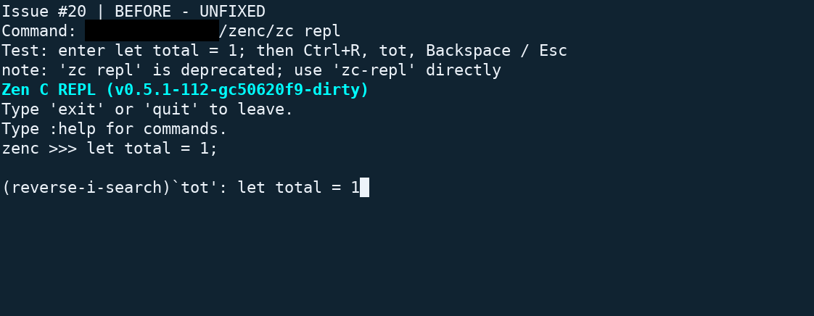
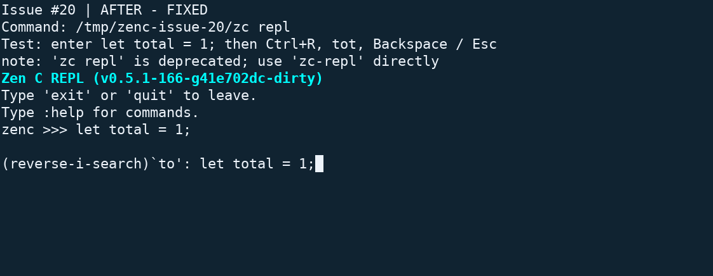
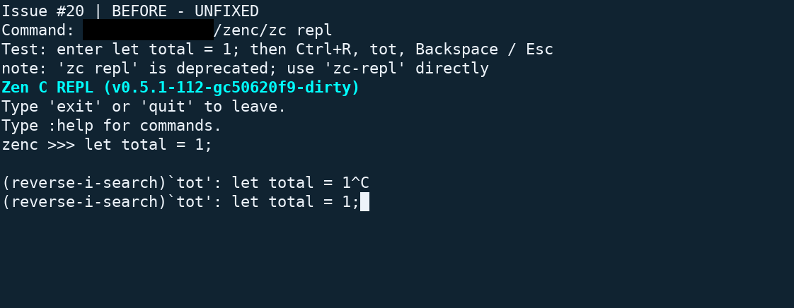
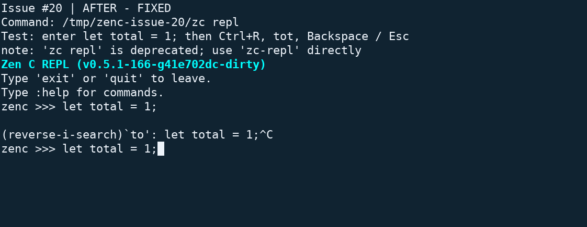
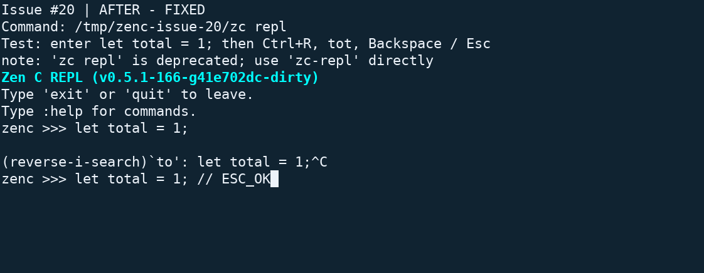

## Description

Fixes zenc-lang-ce/zenc#20.

During reverse history search, the general Backspace and Escape handlers ran before the search handler. Backspace deleted a character from the recalled command instead of the query. Escape waited for the rest of a terminal escape sequence instead of leaving search.

Run those two general handlers only outside search mode. The existing search handlers then shorten the query or accept Escape. Other key handlers retain their existing dispatch order.

Add a Python PTY regression suite to the REPL test runner. It covers both Backspace encodings, a broader query finding the latest match, an empty query, Escape, repeated Ctrl+R, Ctrl+G, Ctrl+C, Enter, and normal editing with arrow keys.

## Type of change

- [x] Bug fix

## Terminal screenshots

Both runs entered `let total = 1;`, pressed Enter, then pressed Ctrl+R and typed `tot`. Backspace and Escape were tested in separate searches. Each run used an isolated history directory.

The before screenshots have a black rectangle over the local account path. Every pixel outside that rectangle is unchanged. The fixed screenshots are unedited.

### Backspace

Before: the query stays `tot`, while the recalled command loses its `;`.

After: the query becomes `to`, while `let total = 1;` stays intact.

### Escape

Before: a standalone Escape leaves the reverse-search prompt visible and produces no redraw during the observation interval.

After: a standalone Escape returns to the normal `zenc >>>` prompt and keeps the recalled command.

Typing ` // ESC_OK` after Escape also works. The line below is still being edited; it was not submitted.

The screenshots compare the existing unpatched `c50620f9` build with a `41e702dc` build containing this fix. The source and tests are now committed as [97f5c99f](https://github.com/paulboul1013/zenc/commit/97f5c99f9cd5338f7dde5c92689a21883feae3b7). Image URLs use an immutable evidence commit.

## Validation

- Initial PTY reproduction: 9 tests, 5 failures. Fixed PTY suite: 9 tests, 0 failures. The fixed suite passed again before commit.
- `make test CC=gcc-14 ZC_HAS_JIT=0 ZC_TEST_JOBS=4` exited 0 on Linux. Language: 447 passed, 177 skipped; codegen: 6; REPL: 20; CLI: 37; diagnostics: 53; check-clean: 17; C unit tests: 106; MISRA: 173 passed.
- `make format-check CLANG_FORMAT=clang-format-18`, `bash -n tests/scripts/run_repl_tests.sh`, and `git diff --check` passed.

### Validation limits

The libFuzzer target built, but fuzzing found a `lexer_next` use-after-poison. Replaying the same input on unmodified `41e702dc` produced the same error at `src/lexer/token.c:509`. Fuzzing is not reported as passed.

Example-repository tests were skipped because that separate repository was absent. JIT-enabled builds, macOS, and Windows were not tested. The new PTY suite requires Python 3 and skips non-POSIX hosts.

## Merge danger

This is a reversible change to two conditions in `repl_readline`. It changes no public interface, syntax, or file format. The regression suite adds a Python 3 requirement to the REPL test runner.

Screenshot evidence lives on a separate fork branch. The proposed code branch changes only the REPL source and two test files.

## Checklist

- [x] Reviewed the code against the issue's expected behavior.
- [x] Added regression tests that demonstrated the failure before the fix.
- [x] Ran the complete existing test suite and the terminal checks described above.
- [x] Disclosed skipped coverage and the pre-existing fuzzer failure.

No new syntax or CLI behavior needs documentation.
